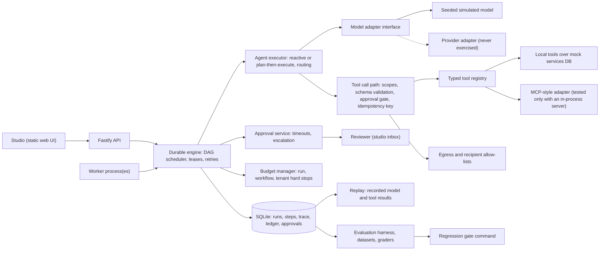

<p align="center"></p>

<p align="center">
  
  
  
</p>

# AI Agent & Workflow Automation Platform

> Build, run and evaluate tool-using AI agents with approvals, budgets and full traces.

A platform for composing agents and deterministic steps into durable workflows. Every run is traceable, every tool call is permissioned, spend is capped, and a built-in evaluation harness tells you whether a change made the agent better or worse.

**Read this first.** There is **no real language model anywhere in this project**. No API key was available, so every run, test and experiment uses a deterministic, seeded **simulated model** whose behaviour (malformed arguments, wrong tools, silent mistakes, obeying injected instructions) is set by documented parameters. External services are local stand-ins. A real-model adapter exists as an implemented interface that was written against the provider documentation and **never exercised**. Everything reported here therefore tests the platform's mechanisms under assumed model behaviour, not the quality of any real model.

**Quick links:** [Architecture](#architecture) · [Tech stack](#tech-stack) · [Experiment results](#experiment-results-simulated) · [Engineering decisions](#engineering-decisions) · [Roadmap](#roadmap) · [Case study](docs/case-study.md) · [Research report](docs/research-report.md)

> **Public showcase.** This repository holds the documentation, client case study, research report and measured results for this product. The runnable source code is distributed separately under a license: see [SOURCE-ACCESS.md](SOURCE-ACCESS.md).

## At a glance

|                    |                                                                                                                                                                                                                             |
| ------------------ | --------------------------------------------------------------------------------------------------------------------------------------------------------------------------------------------------------------------------- |
| **Track**          | Career · Advanced                                                                                                                                                                                                           |
| **Phase**          | Beta: all five milestones are built and tested, and all four experiments have recorded results, all against a simulated model. Not production software: single node, no authentication, no real model or real integrations. |
| **Primary reader** | Hiring managers and engineering leads                                                                                                                                                                                       |
| **Read next**      | [README](README.md) · [Client case study](docs/case-study.md) · [Research report](docs/research-report.md)                                                                                                                  |

## Why this exists

Teams can get an agent demo working in an afternoon and then spend months on the unglamorous parts: retries and resumption, permissions, human approvals, cost control, and knowing whether last week's prompt change broke anything. This project builds those parts and tests them against a simulated model that can be made to misbehave on demand.

## What it does (everything below is built and tested)

- **Workflows as data:** versioned JSON DAGs with agent steps, tool steps, transforms, `{{template}}` references, conditional steps and approval steps; validated on save (unknown tools, cycles, dangling references). Steps within one run execute one at a time.
- **Typed tool registry:** nine shipped tools over local mock services (order, customer, knowledge-base and invoice lookups, a sum, ticket creation, email, refunds and a web fetch), each with a JSON-schema input contract (ajv), required permission scopes, side-effect class, approval rule, output-trust flag and a model-tier hint.
- **One enforcement path for every tool call:** exposure check, permission scopes, schema validation (off, on and fail-closed, or on with repair), approval gate, execution under an idempotency key, output trust tagging and a heuristic injection scan.
- **Agent strategies:** reactive loop and plan-then-execute (with repair and replanning), plus model routing (single, error-triggered cascade, tool-tier routing).
- **Durable execution:** run and step state in SQLite, worker leases, retries with exponential backoff and jitter, idempotency keys that make side effects exactly-once at the service, and resume after a crash. Tested with in-process crash points and with real worker processes killed by `SIGKILL`.
- **Human approvals:** gates on tools or as workflow steps, with escalation chains and **fail-closed** timeouts (an undecided request expires and counts as a rejection; there is no auto-approve).
- **Budgets:** per-run, per-workflow and per-tenant token and cost-unit limits, reserved before each model call so spend can never cross a limit.
- **Tracing and replay:** every prompt, response, tool call, validation result, approval and cost is recorded; a run can be replayed deterministically against its recorded model responses and tool results, and a changed prompt or setting is reported as a divergence.
- **Evaluation harness:** versioned, content-hashed datasets, programmatic graders (state checks, answer checks, tool-use and cost limits, unsafe-effect checks), an LLM-judge grader that exists **only as an interface**, and a regression gate command that exits non-zero when success rate drops, mean cost rises or more runs hit budget stops.
- **MCP-style tool adapter:** a client over JSON-RPC 2.0 implementing initialize, tools/list (paged) and tools/call from the open MCP specification, exposing server tools as registry tools with conservative defaults. Tested **only** against a local in-process test server.
- **Egress allow-list and recipient allow-list** enforced at the tool-adapter layer. This is an application-level check, **not an OS-level sandbox**.
- **Studio (web UI):** workflow graph view (SVG) next to a JSON editor, run list and run detail, trace viewer with replay, approval inbox, budgets and evaluation results.

## Architecture



## Tech stack

| Layer                | Technology (what was actually used)                                                                              |
| -------------------- | ---------------------------------------------------------------------------------------------------------------- |
| Language and runtime | TypeScript 6 (strict) on Node.js 25                                                                              |
| API                  | Fastify 5                                                                                                        |
| Durable state        | Built-in `node:sqlite` (WAL mode) with a purpose-built scheduler, leases and ledger                              |
| Validation           | ajv 8 with ajv-formats (tool schemas and workflow definitions)                                                   |
| Studio               | Plain JavaScript modules and SVG served by the API (no framework, no build step)                                 |
| Model                | Seeded simulated model; provider adapter written against the Messages API documentation, never exercised         |
| Tool protocol        | Hand-written MCP client (JSON-RPC 2.0) with an in-process test server                                            |
| Tests and quality    | Vitest 4, ESLint 10 with typescript-eslint, Prettier                                                             |
| CI                   | GitHub Actions workflow with the same commands as local plus a build and an SBOM step; **never run** (no runner) |

Changes from the original plan, with reasons: Next.js and React Flow became a dependency-free studio (less to build and to break); Postgres, pgvector and Temporal became SQLite and an own scheduler (no database service available, one fewer moving part); a containerised tool sandbox became an in-process egress check (Docker is not available; stated plainly as not a sandbox); OpenTelemetry became a trace table in SQLite; "Claude API first" became a simulated model first (no key).

### Local stand-ins for external services

| Real-world dependency                     | Stand-in used here                                                                             |
| ----------------------------------------- | ---------------------------------------------------------------------------------------------- |
| LLM provider                              | Deterministic seeded simulator with configurable error, slip, routing and compliance behaviour |
| Ticketing, email, payments, outbound web  | Idempotent tables in a separate SQLite database and a tiny in-memory fake web                  |
| Customer, order and invoice data          | Synthetic records generated from a seed                                                        |
| Remote MCP servers                        | A local in-process test server written from the specification                                  |
| Human reviewers                           | The studio inbox, or a seeded reviewer function in experiments (assumed accuracy, labelled)    |
| Cloud hosting, containers, Postgres, OTel | None                                                                                           |

## Experiment results (simulated)

Four experiments were run **once** against the simulated model; protocol, parameters, decision rules, full tables, threats to validity and the change log are in the [research report](docs/research-report.md), and the raw per-run rows are in [results/](results/e1/summary.md). All numbers are conditional on assumed model behaviour.

| Experiment           | Headline (95% intervals in the report)                                                                                                                                                                           | Verdict under the pre-registered rule                                                                                       |
| -------------------- | ---------------------------------------------------------------------------------------------------------------------------------------------------------------------------------------------------------------- | --------------------------------------------------------------------------------------------------------------------------- |
| E1 schema validation | Repair vs no validation: +7.0 pp success at +2.8% cost (large model), +18.7 pp at +11.5% cost (small model). Fail-closed validation without repair was **worse than none** (-16.7 and -29.0 pp).                 | H1 supported for the large model; for the small model the success gain held but the cost interval reached 15.3% (limit 15%) |
| E2 planning strategy | Plan-then-execute ahead by about 3 to 5 pp in every length bin; no bin significant after Holm correction; gain mostly disappears in a control arm without context growth.                                        | H2 **not supported**                                                                                                        |
| E3 model routing     | Tool-tier routing: cost per success x0.57 with success unchanged (+0.5 pp). Error-triggered cascade: x0.38 cost but **-15.8 pp** success.                                                                        | H3 supported for tool-tier routing, **not** for the cascade                                                                 |
| E4 safety gates      | Approval gates alone caught 86.6% of unsafe attempts with 45% of runs needing review; scopes, allow-lists and approvals together caught 98.9% with 26% review. Always-compliant arm: gates-only review rate 75%. | H4 supported at default compliance; intervention bound **exceeded** in the always-compliant arm                             |

## Engineering decisions

### Workflows are data, runs are replayable

Workflow definitions are versioned JSON and a run keeps a snapshot of the definition it started with. Every run persists inputs, tool outputs, model requests and responses, so a run can be replayed deterministically against its recorded results, and a counterfactual replay (changed prompt, system message or validation mode) reports exactly where it diverges.

### Exactly-once effects come from idempotency keys, not from luck

A tool call's effect is requested under a key derived from (run, step, call index). The service deduplicates on the key, so a worker that dies after the effect but before recording it simply repeats the request on resume and gets the original record back. Crash tests assert exactly-once counts after kills at every named point and at random moments.

### Least-privilege tools

Each tool declares scopes and a run carries a grant list; a tool the run is not granted is refused even if the model asks for it. This is a permission check inside the platform. The platform does not mint credentials: tools talk to local stand-ins and there are no real credentials to protect.

### Fail closed

Undecided approvals expire as rejections, strict validation without repair terminates the step, budget checks happen before the model call, and unknown tools, hosts and recipients are refused.

### Evaluation is part of the platform

Datasets are versioned and content-hashed, graders are programmatic, and a regression gate command compares a candidate against a stored baseline. Changing a prompt or a model is meant to be a change that must pass it, the way code must pass tests; wiring the gate into merge protection is not done.

## Quality bar

- 143 automated tests in 12 files: unit, integration, crash-and-resume (including real `SIGKILL` of worker processes), prompt-injection tests for each of the nine shipped tools (direct arguments and indirect tool output), budget hard-stop tests including an invariant check across 25 seeds, replay, gate command exit codes, MCP, HTTP API and an experiment-harness smoke test.
- TypeScript strict mode, ESLint and Prettier configured and clean.
- A CI workflow with the same commands as local; **it has not been run** (no CI runner was available while it was written).
- Not set up: secret scanning (a hosting-side setting). A Dependabot configuration and an SBOM step exist but are unrun.

## Roadmap

- [x] M1: single-agent workflow with typed tools, tool registry with permission scopes, simulated-model adapter and full tracing (verified by tests)
- [x] M2: durable DAG execution with persisted step state, retries with backoff, idempotency keys and resume after crash (verified by in-process and real-process kill tests)
- [x] M3: approval gates with timeouts and escalation, and per-run, per-workflow and per-tenant budgets with hard stops (verified by tests)
- [x] M4: evaluation harness with versioned datasets, programmatic graders, regression gate command and deterministic replay (verified by tests and a gate demonstration)
- [x] M5: studio with graph view, JSON editor, trace viewer, approval inbox and evaluation results; MCP-style adapter tested against a local in-process server; egress allow-list at the adapter layer (verified by tests; the studio was also exercised by hand in a browser)
- [x] Experiments E1 to E4 run once with recorded results
- [ ] A real model provider run (adapter exists, never exercised)
- [ ] CI workflow executed on a runner

## Not built yet / out of scope

| Item                                                       | Reason                                                                                                                                    |
| ---------------------------------------------------------- | ----------------------------------------------------------------------------------------------------------------------------------------- |
| Any real LLM call, evaluation or claim                     | No API key was available or requested; the provider adapter is untested against the live API                                              |
| LLM-judge grader implementation                            | Interface only; no model to back it                                                                                                       |
| OS-level or container sandbox for tools                    | Docker unavailable; the egress check is an application-level control and can be bypassed by code that does not use the platform's context |
| Real MCP servers, stdio or HTTP transports with real peers | Only an in-process test server was available; the stream framing is tested over in-memory streams only                                    |
| Authentication, tenants as identities, TLS                 | Out of scope for a local prototype; the API binds to loopback and the tenant id is a plain field                                          |
| Parallel step execution inside one run                     | Steps of a run execute sequentially; independent branches are scheduled, not concurrent                                                   |
| Postgres, pgvector memory and retrieval, Temporal          | Replaced by SQLite and an own scheduler; no retrieval or memory feature exists                                                            |
| OpenTelemetry export, dashboards beyond the studio views   | Traces live in SQLite and the studio                                                                                                      |
| Tenant or workflow budget caps during replay               | Replay reproduces run-level budgets only                                                                                                  |
| Latency measurements                                       | Not meaningful with a simulated model on a shared machine                                                                                 |
| Secret scanning, merge protection on the gate              | Hosting-side settings; not configured                                                                                                     |

## Getting started

> _These instructions refer to the source package, which is distributed separately and is not part of this showcase repository._

These are the commands that were run from a clean copy of the folder (without `node_modules` or `.tmp`) at a short path. You need Node.js 24 or newer (developed on 25.9) and npm. No API key, network service or Docker is needed.

```
npm ci
npm run check          # format check, lint, type check, all tests, regression gate
npm run build          # compile to dist/
npm start              # studio and API on http://127.0.0.1:8787
```

Set `PORT`, `HOST` or `AAP_DATA_DIR` in the environment to change the defaults (see `.env.example`). The studio seeds four demo workflows. Start one from the Workflows tab, watch it in Runs, open its Trace and press Replay, and decide approvals in the Approvals tab. Data is stored under `data/` (git-ignored).

Other commands:

```
npm run worker -- --data-dir data     # a standalone worker process (the server also runs one in-process)
npm run dataset:build                 # regenerate datasets/support-core/v1.json
npm run eval                          # evaluate the default configuration, writes results/eval/default.json
npm run eval:baseline                 # rewrite evals/baselines/default.json
npm run gate                          # exit 1 on a regression against the baseline
npm run gate -- --config evals/configs/regressed.json   # a deliberately regressed candidate: exits 1
npm run gate:demo                     # four gate scenarios, writes results/gate-demo.json
npm run replay -- <runId> --data-dir data
```

## Verification

> _These instructions refer to the source package, which is distributed separately and is not part of this showcase repository._

```
npm test                    # 143 tests, about 70 s on a loaded machine (the process-kill tests dominate)
npm run experiments         # all four experiments (about 7 minutes on the development machine); overwrites results/e1..e4
npm run experiment:e1       # also e2, e3, e4; add -- --smoke for a reduced run that writes to .tmp/ only
```

On the development machine all 143 tests passed from a clean install at a short path. The experiment scripts record the code digest, Node version, hardware, CPU load and seeds next to every result file.

## Repository layout

> _These instructions refer to the source package, which is distributed separately and is not part of this showcase repository._

```
src/engine/       durable engine, agent executor, approvals, budgets, replay, crash injection
src/tools/        registry, nine shipped tools, mock services, egress guard, injection detector
src/model/        simulated model and profiles, recorded model (replay), provider adapter (never exercised)
src/mcp/          MCP client, adapter, in-process test server, transports
src/eval/         datasets, graders, runner, regression gate, shared task runner
src/tasks/        task programs (ground truth) and task generator
src/server/       Fastify API and demo workflows
src/cli/          worker, eval, gate, replay and dataset commands
studio/           web UI (plain modules and SVG)
experiments/      E1 to E4, attack scenarios, shared statistics and provenance code
tests/            unit, integration, crash/kill, injection, replay, MCP, API
datasets/ evals/  versioned evaluation dataset, configs and the committed baseline
results/          raw rows and summaries of every experiment, evaluation and gate demonstration
docs/             case study and research report
```

## Skills demonstrated

`LLM application architecture` · `Durable workflow design` · `Agent security controls` · `Evaluation engineering` · `TypeScript platform development` · `Cost and reliability engineering` · `Honest experimental method`

## One project, three lenses

The same project is documented for three audiences, so one body of work serves every goal.

| If you are…                        | Read                                       | You will find                                                                                                                    |
| ---------------------------------- | ------------------------------------------ | -------------------------------------------------------------------------------------------------------------------------------- |
| Hiring or reviewing engineers      | [This README](README.md)                   | Architecture, trade-offs, quality bar and what I would defend in a design review                                                 |
| A client or founder                | [Client case study](docs/case-study.md)    | The business problem, the value levers, how it is measured and how an engagement runs                                            |
| A researcher or technical reviewer | [Research report](docs/research-report.md) | Hypotheses, decision rules, simulated-model parameters, results with intervals, threats to validity and the reproducibility list |

## Author

Built by **[The Diamond Empire](https://thedempire.shop/)**.
