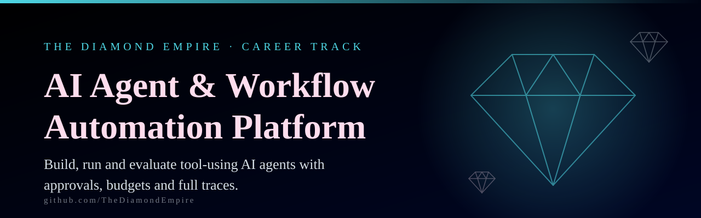

# AI Agent & Workflow Automation Platform: Client Case Study

> Automate multi-step work with auditable AI and a human in control of anything that matters.

> **Status of this document.** This is a reference case study: it sets out the business problem, the solution and the value model. The results table is intentionally blank and is filled in only from measured data (a pilot or a real engagement). No outcome figures are claimed here. The platform itself is a single-node prototype that runs against a simulated model and local stand-in services; nothing in it has been run against a real model or a client's systems.

## Snapshot

|                   |                                                                                                                       |
| ----------------- | --------------------------------------------------------------------------------------------------------------------- |
| **Who it is for** | Operations, support and revenue teams that want to automate multi-step knowledge work without losing control.         |
| **Solution**      | Build, run and evaluate tool-using AI agents with approvals, budgets and full traces.                                 |
| **Track**         | Career · Advanced                                                                                                     |
| **Delivered by**  | The Diamond Empire                                                                                                        |
| **Maturity**      | Working prototype (single node, SQLite, simulated model); see the [README](../README.md) for what is and is not built |

## The challenge

Manual triage, data entry and follow-up consume skilled hours. Off-the-shelf automations are brittle, and early AI pilots stall because nobody can show they are safe, accurate or affordable.

## The solution

A platform for composing LLM agents and deterministic steps into durable workflows. Every run is traceable, every tool call is permissioned, spend is capped, and a built-in evaluation harness tells you whether a change made the agent better or worse.

What the client gets in practice (all of these exist in the prototype and are covered by automated tests):

- Workflows defined as versioned JSON DAGs mixing agent steps, tool calls, conditional branches and human approvals, with a studio that draws the graph and shows every run
- Typed tool registry with JSON-schema validation and per-tool permission scopes, plus an MCP-style adapter (implemented against the open specification, tested only against a local in-process test server)
- Durable execution: retries with backoff, idempotency keys and resume-after-crash from persisted state (tested by killing worker processes mid-run)
- Human-in-the-loop approval gates with timeouts (fail closed) and escalation chains
- Token and cost-unit budgets per run, per workflow and per tenant, enforced as hard stops before a model call is made
- Full traces of prompts, tool inputs and outputs and cost, with deterministic replay of a recorded run against its recorded results

What a client engagement would still have to add: a real model provider integration and its evaluation, real tool integrations, authentication, a production database and hosting. None of these are in the prototype.

## How it creates value

| Value lever       | How the solution delivers it                                                               | How we measure it                                                           |
| ----------------- | ------------------------------------------------------------------------------------------ | --------------------------------------------------------------------------- |
| Labor hours       | Agents handle repetitive triage, drafting and lookups; people review exceptions            | Hours saved per workflow run; share of tasks completed without intervention |
| Quality and trust | Evaluation suites and approval gates keep accuracy measurable                              | Task success rate vs. human baseline; error escape rate                     |
| Cost control      | Per-run, per-workflow and per-tenant budgets and model routing keep spend predictable      | Cost per completed task; budget breaches                                    |
| Risk reduction    | Scoped tools, allow-lists, approval gates, audit trails and replay support security review | Audit findings; time to answer "what did the agent do?"                     |

## How an engagement runs

| Phase    | What happens                                           |
| -------- | ------------------------------------------------------ |
| Select   | Pick workflows by volume, risk and measurability       |
| Baseline | Measure the current manual process                     |
| Pilot    | Run agents with approvals on, compare against baseline |
| Scale    | Relax approvals where evaluation data justifies it     |

## What the client receives

- A self-hosted deployment of the platform (the prototype is single-node; hosting and scaling work would be scoped with the client)
- Two to three production workflows built with the client's team
- Evaluation dataset and success criteria agreed up front (the harness, dataset format and regression gate already exist)
- Approval and escalation policies
- Budget limits per tenant and workflow, visible in the studio, and a runbook written for the client's environment

## Results

Baseline measurements are taken **before** the solution goes live, and the same measures are taken after, so every change in the table is attributable and honest.

| Measure           | How measured                                                                | Baseline | After | Change |
| ----------------- | --------------------------------------------------------------------------- | -------- | ----- | ------ |
| Labor hours       | Hours saved per workflow run; share of tasks completed without intervention | —        | —     | —      |
| Quality and trust | Task success rate vs. human baseline; error escape rate                     | —        | —     | —      |
| Cost control      | Cost per completed task; budget breaches                                    | —        | —     | —      |
| Risk reduction    | Audit findings; time to answer "what did the agent do?"                     | —        | —     | —      |

> **To fill in:** replace each — with measured values and add the measurement window and sample size beneath the table.

## How quality and risk are managed

- Prompt-injection tests run against every shipped tool (arguments and tool output), asserting that the platform's controls hold even when a simulated model obeys the injected text
- Crash tests kill a real worker process mid-run (at named points and at arbitrary moments) and assert exactly-once side effects after resume
- A regression gate command fails when success rate drops or budget stops increase against a stored baseline; wiring it to block merges needs branch protection on the hosting side, which is not configured
- A dependency-update configuration and an SBOM step are in the CI workflow, which has not been run; secret scanning is a hosting-side setting and is not configured

## Is this a fit?

Best suited to: operations, support and revenue teams that want to automate multi-step knowledge work without losing control.

## Talk to me

Want this adapted to your business? Get in touch via **[thedempire.shop](https://thedempire.shop/)**.

---

[README](../README.md) · [Client case study](case-study.md) · [Research report](research-report.md)
